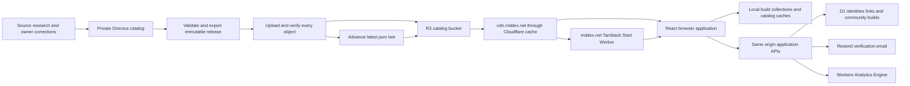
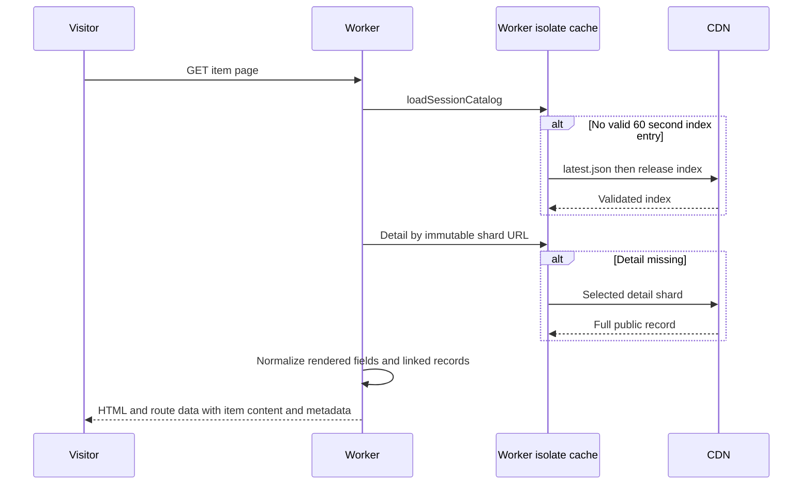
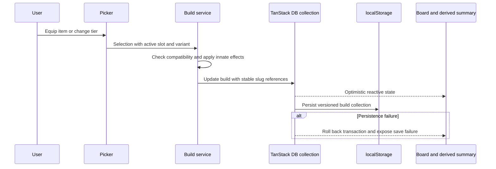

# MDDEX architecture and performance plan

MDDEX is a local-first Minecraft Dungeons 2 build maker with a published game catalog, reference pages, resource tools, and public community builds. Its main performance advantage is that ordinary equipment selection, filtering, build calculations, and autosave happen in the browser. Network requests supply catalog definitions and support explicit sharing and community actions.

The architecture has three independently operated parts: a private content authoring and publishing system, a public R2 content CDN, and the MDDEX application on Cloudflare Workers. Keeping these boundaries intact lets content updates ship without rebuilding the application and lets users continue editing when server features are unavailable.

This describes application release 2.1.0 and the adjacent `mddb-cdn` project as of 8 October 2026. Repository configuration and publishing runbooks describe the deployment setup; they are not a fresh audit of production. Sections titled “Proposed” describe work to do. Timing budgets are acceptance targets, not measured results.

## System topology



The public application never queries Directus. Browsers fetch published catalog JSON and artwork directly from the CDN. Server-rendered catalog routes also read that feed. D1 stores application identities and deliberately published snapshots; it is not the game catalog database or an automatic replica of browser loadouts.

| Component | Responsibility | Persistent state |
| --- | --- | --- |
| `mddb-cdn` private project | Research, owner overrides, CMS editing, export validation, publication | Directus SQLite database, controlled uploads, maintenance and provenance records |
| R2 bucket `mddb-catalog` | Immutable catalog release JSON and shared artwork | Historical releases, image objects, mutable release pointer |
| CDN `cdn.mddex.net` | Public delivery, compression, CORS, edge caching | Cloudflare caches in front of R2 |
| Worker `mddex` at `mddex.net` | HTML rendering, routing, sitemap, application APIs | Runtime bindings; in-process caches are disposable |
| D1 `mddex-builds`, binding `BUILD_DB` | Anonymous users and sessions, immutable links, community posts and verified identities | SQL tables and indexes from migrations |
| Browser | Reactive workspace, filters, calculations, local saves, disposable definition caches | localStorage, IndexedDB, browser HTTP/image cache |
| Resend | Deliver email verification codes | Provider delivery state; application authorization remains in D1 |
| Analytics Engine `mddex_events` | Allowlisted product events | Event records used by reporting scripts |

## Application stack and module boundaries

The application uses React 19, TypeScript, TanStack Start and Router, TanStack DB through `@tanstack/react-db`, HeroUI v3, Tailwind CSS v4, and Zod. Vite combines the Start, React, Tailwind, and Cloudflare plugins. The Cloudflare plugin targets the SSR environment; production output has client assets and a Worker server bundle.

`src/server.ts` is the Worker entry point. It applies the production HTTPS redirect, dispatches community, sharing, identity, analytics, and sitemap requests, then delegates page rendering to the TanStack Start server entry. `src/router.tsx` enables scroll restoration and intent preloading. Its default preload freshness is 60 seconds; catalog and detail routes override route freshness with `Infinity`, consistent with a pinned browser catalog.

| Area | Main responsibility |
| --- | --- |
| `src/features/catalog` | Release discovery, schema validation, session pinning, IndexedDB, artwork warming, common catalog helpers |
| `src/features/catalog-details` | Detail loading, render-specific projection, relationships, acquisition sources, metadata and dossier UI |
| `src/features/builds` | Build schemas, local collections, mutations, eligibility, unique effects, tiers, variants, summaries and costs |
| `src/features/collection` | Read-only catalog views, search, filtering and sort presentation |
| `src/features/sharing` | Anonymous identity, compressed snapshot links, D1 link creation and resolution |
| `src/features/community` | Public posts, gallery, structured descriptions, email authorization and display-name ownership |
| `src/features/resources` | Tracker, weapon reference data, and Soul Storm guides and route tools |
| `src/features/seo` | Canonical metadata, directory links and sitemap generation |
| `src/features/analytics` | Browser event identity and queue, ingestion and reporting contract |

The build service enforces the same eligibility rules used by the picker. UI filtering is therefore not the only defense against incompatible equipment. Keeping rules outside components also makes local saves, shared imports, and community snapshots follow the same interpretation.

## Content authoring and publication

### Private authoring setup

The adjacent `../mddb-cdn` project runs Directus `12.4.1` in Docker, with a SQLite database and uploads/extensions mounted under private `.data` directories. Directus binds to `127.0.0.1:8055`; a local editor binds to `127.0.0.1:3000` and proxies CMS access. Neither service participates in public page requests.

Directus `catalog_entries` is canonical. The current owner scope fixes catalog membership to the dungeons.tools launch dataset; Wikily supplies primary detailed gear and mob evidence. Other evidence enriches those identities. Stable IDs/slugs, owner overrides, and per-field provenance must survive source refreshes.

### Release contract

An export generates the following logical objects:

```text
latest.json
releases/<immutable-version>/
  manifest.json
  catalog-index.json
  details/<opaque-entry-path>.json
  catalog.json
images/<sha256>.<extension>
```

`catalog-index.json` is the compact browsing and build contract. It contains canonical identity, display fields, selected artwork, supplied detail paths, and an explicit allowlist of core game data. That core includes stats, tiers, levels, innate effects, rollable effect pools, enchantment eligibility, compact relationships, and acquisition/directory information needed by the application.

Each detail shard contains one complete public record with its full enrichment and provenance. It links to other records by canonical slug rather than embedding their complete content. `catalog.json` preserves the full compatibility format for older consumers. Build must not acquire a dependency on complete quests, maps, research pages, or provenance.

The manifest records counts, hashes, byte sizes, and content types. Version generation incorporates exact serialized objects and storage mode. New remote releases use `imageStorage: "shared"`: data references resolve to CDN-root image URLs identified by byte hash. Local export archives still contain image copies for a self-contained transfer. Historical releases and referenced images remain available.

### Publication flow

1. Read canonical CMS records and controlled artwork; apply the export contract without changing identities.
2. Validate the compact projection, complete shards, references, counts, and hashes.
3. Upload release JSON. Reuse shared images only after confirming their bytes match; upload missing images and read them back.
4. Read back and verify every required object. A corrupt immutable image blocks publication.
5. Advance `latest.json` only after complete verification succeeds.
6. Run the public CDN verifier for compression, caching, CORS, pointer freshness and decoded content hashes.

The pointer is the commit boundary. Partial uploads do not expose a partial release. An interrupted run can resume verification of its pinned export without blindly re-uploading everything. REST requests are paced, with rate-limit retry handling, so expanding the shard count does not create uncontrolled upload bursts.

See the adjacent project's [shard contract](../../mddb-cdn/docs/catalog-shards.md) and [CDN runbook](../../mddb-cdn/docs/cdn.md).

## CDN delivery and freshness

The documented CDN configuration attaches the existing R2 bucket directly to `cdn.mddex.net`; there is no catalog proxy Worker. Scoped rules make release JSON and shared images eligible for edge caching, compress JSON with Brotli or Gzip, supply public read-only CORS even on cache hits, and prevent caching HTTP 400–599 errors. Tiered Cache and Smart Tiered Cache are enabled in the documented setup.

| Object | Cache policy | Reason |
| --- | --- | --- |
| `latest.json` | Edge bypass; object/browser policy `public, max-age=60, must-revalidate`; application fetch uses `cache: "no-cache"` | Discover the current release without an old edge pointer |
| Release index, shards, compatibility catalog and manifest | `public, max-age=31536000, immutable` | A versioned object never changes |
| Shared hashed images | Same one-year immutable policy | Unchanged image bytes keep the same URL across releases |

The custom domain is essential for this delivery architecture. Cloudflare documents that `r2.dev` lacks its caching features and that JSON requires suitable cache rules. [Cloudflare R2 caching documentation](https://developers.cloudflare.com/cache/interaction-cloudflare-products/r2/).

Image references such as `../../images/<hash>.webp` resolve against the pinned release directory. Adding a release query parameter to an already hashed image would fragment cache reuse. The application resolves supplied paths; it does not infer release directories from version strings.

The browser reads the pointer's manifest path to establish the authoritative release directory. It does **not** fetch the manifest inventory or verify every asset hash during normal browsing; complete byte verification belongs to publication and CDN verification. Runtime loading validates schemas, unique slugs, detail identity, and release path confinement.

## Server data flows

### Direct page arrivals and server rendering

A direct `/build` arrival renders the introduction, metadata, and workspace shell. Browser collections and the interactive catalog initialize after hydration; a private local build is not part of server HTML.

A direct `/collection` arrival runs the route loader against the published index and returns a compact directory of canonical links. The interactive grid loads its catalog in the browser. This preserves crawlable links without serializing the entire game catalog into the route payload. `/mobs` provides the corresponding reference directory behavior.

A direct `/catalog/<category>/<slug>` arrival takes a different path:



The server waits for the selected detail so initial HTML includes the complete rendered dossier and SEO metadata. It then removes unused enrichment fields and returns only the related catalog records needed by the page. Complete source provenance and unrelated records do not need to inflate the HTML/router payload.

Catalog requests are coalesced per source for 60 seconds within each Worker isolate. Immutable detail requests are keyed by shard URL and retained in a bounded 128-entry map. Failed requests are removed so retries can work. This is process-local reuse: another isolate or a restarted isolate may fetch again. The detail map evicts by insertion order, not a true least-recently-used policy.

Missing `/assets/` requests reaching the Worker return a plain-text 404 with `no-store`, rather than the HTML fallback. The router and Vite preload-error handler recover stale lazy imports with a page reload limited to once per 30 seconds through sessionStorage. Blocked storage disables automatic reload to avoid loops. This handles stale tabs after deployment; it does not retain previous deployments' asset files.

`/sitemap.xml` currently calls `loadCatalog()` directly, rather than the shared session loader. Its response advertises browser freshness of 300 seconds and shared-cache freshness of 3600 seconds. Those headers are not proof that the deployed Worker response is served from an edge cache.

### API boundaries and persistence

| Endpoint family | Flow | Response caching |
| --- | --- | --- |
| `/api/identity` | Issue or renew an anonymous session; return public identity while setting an HttpOnly credential cookie | `no-store` |
| `POST /api/build-links` | Validate token and anonymous session; commit an immutable snapshot link in D1 | `no-store` |
| `GET /api/build-links/<id>` | Resolve the immutable token | Successful token responses advertise one-year public immutable caching; errors do not |
| `/api/community-builds` | List, read, publish, edit or soft-delete public snapshots | Current responses use `no-store` |
| `/api/community-builds/auth/*` | Request/verify an email code or inspect the verified session | `no-store` |
| `/api/analytics` | Validate bounded allowlisted events and write Analytics Engine points | `no-store` |

Sharing and community handlers use `BUILD_DB.withSession("first-primary")`. Their first database access goes to the primary, favoring current identity and mutation state. This code alone does not establish that read replication is enabled or providing geographic read acceleration.

The configured `SHARE_RATE_LIMITER` permits 60 requests per 60 seconds for the keys used by those handlers. Same-origin/content-type checks, payload bounds, schemas, session credentials and idempotency complement that limit. The limiter is a request guard, not a queue or an application data cache.

### D1 data model

`users` and `anonymous_sessions` separate public anonymous identity from hashed session credentials. `build_links` stores the immutable compressed token and creator ID; uniqueness on creator and token hash makes identical submissions idempotent.

Community tables store published snapshot JSON, structured descriptions, tags, public display identity and private ownership data. Email challenges and email sessions support verification. `community_profiles` reserves a unique normalized display name for each verified email. State/recent indexes support published gallery ordering. Earlier community edit tables remain part of migration history; current authorization uses verified email sessions.

Soft deletion retains the community row and ownership but removes it from public reads, search and editing. Existing retry keys cannot republish or restore that deleted row.

## Browser data flows

### Cold application start

For a browser without a saved catalog, the content critical path is:

```text
Application HTML and JS → browser initialization
  → latest.json → pinned catalog-index.json → validate and resolve paths
  → workspace or catalog ready
```

The pointer and index are sequential because the pointer supplies the index path. The loader applies a 15-second combined network deadline. IndexedDB access is best effort; successful content can be used even if persistence fails.

Build starts catalog acquisition while preloading the local build and preference collections. A shared-link arrival also starts link resolution early. These independent activities overlap. If there are no local builds, the workspace creates and persists one empty loadout and its active preference. The root document preconnects to the content origin to reduce connection setup overhead.

### Returning browser and release pinning

`loadSessionCatalog()` first reads a validated snapshot from IndexedDB. When one exists, it returns its items without waiting for a pointer request and starts revalidation in the background. A complete changed snapshot is written for the **next full page load**. The current page keeps the catalog it already selected.

That gives two distinct promises: an immediately usable saved release and coherent definitions for the duration of the page. A late refresh cannot change an equipment rule under an open build or pair an old index with a new detail shard.

The current catalog database constant is `mddex-catalog-v2`, with `snapshots` and `details` stores. Snapshot keys identify the content source; detail keys are immutable resolved shard URLs. Some existing README text still names `mddex-catalog-v1`; the current source uses v2. Catalog storage is disposable and separate from user saves.

In-memory promises coalesce concurrent index and detail requests. Blocked or unavailable IndexedDB falls back to memory; database opening has a 1.5-second bound. A corrupt cached catalog is refetched. Changing the origin or port changes browser storage scope.

### In-app detail navigation

Intent preloading starts route work when the user hovers or focuses a link. Within an already loaded browser session, the detail route:

1. Finds the item in the pinned index.
2. Uses a resolved detail from memory, or tries IndexedDB and promotes a matching result to memory.
3. If no stored detail exists, opens from index data and starts one shard request in the background.
4. Replaces the additional content when the shard arrives; a skeleton reserves the enrichment region meanwhile.
5. On failure, keeps the index-backed item usable and offers retry.

The browser does not need to wait for full enrichment to show the item name, artwork and core information. Direct SSR still waits for the shard because complete first-response HTML serves a different purpose. Returning to a stored detail can work when the content network is unavailable, provided the application itself is already loaded.

### Build mutation and autosave



Builds contain exactly 12 equipment positions: melee, ranged, four armor positions, three artifacts and three talismans. They store slug references, modifier choices and tiers, equipment powers, timestamps and names rather than duplicated catalog definitions. Optional variants preserve a base loadout plus up to seven additional compositions.

`build.compatibility.ts`, the selection service, tier helpers and unique-effect logic control valid choices. Replacing gear preserves compatible editable modifiers, clears incompatible ones, and updates its locked innate effect. Unknown catalog references remain visible and clearable rather than disappearing from the saved build. Imported incompatible selections can produce warnings. Summary and cost calculations derive from the selected variant and pinned catalog; repeated gear effects use the project's additive stacking assumption.

TanStack DB live queries drive the workspace. `mddex.builds.v3` stores loadouts; `mddex.build-preferences.v1` stores the active workspace preferences. Legacy v1/v2 migration retains the original saved data. Unreadable mutable storage is preserved and blocks editing instead of being treated as a disposable cache. Composition changes autosave locally and require no identity, catalog shard, API request, or D1 write once definitions are available.

### Search, filtering and resource tools

Catalog search, category/type/applicability filters, effect matching and sorting run against local data. Catalog filters live in URL search parameters; replacing the URL preserves scroll and back-navigation context. The builder memoizes its search index and eligibility-derived choices. Collection views and their filter outputs are memoized, though collection text construction and sorting still happen on filter recalculation.

Cards use lazy artwork loading. A bounded warmer targets the first 24 filtered catalog results and equipped build items. It starts at idle time, or after a 200 ms fallback, with concurrency three and low fetch priority. Detail hero artwork is eager/high priority through `ItemArtwork`; image decoding is asynchronous there. Static UI assets have small WebP variants, and HeroUI CSS imports individual component styles. Community and resource styles load through route heads.

The resource area combines checked-in reference data and assets with published catalog relationships. The item tracker has its own local saved state and share representation. Those resource saves do not become community posts or build-link rows merely by changing an item. Large reference images and viewers should remain secondary to the active workspace's loading budget.

### Explicit sharing

Snapshot encoding runs locally in advance using the browser compression APIs. Version 1 tokens hold a single loadout; version 2 tokens wrap variants. The current token format has an 8192-character bound. Encoding may temporarily disable Share while a new token is being prepared, but it does not delay equipment mutations.

The header warms anonymous identity in the background. Clicking Share captures the prepared token and either reuses a confirmed link or calls `POST /api/build-links`. A first short link is copied only after D1 confirms its snapshot. Clipboard access starts in the click gesture, with a promise-backed `ClipboardItem` when available.

Failure or an offline first share falls back to `/build#build=<token>`, which contains the snapshot itself. Subsequent shares of the same confirmed token can use `/build?share=<id>` immediately. The browser retains the most recent 25 confirmed ID/token pairs and coalesces creation and resolution requests.

A recipient with no saved token must resolve a short ID over the network. This happens alongside catalog and local collection initialization; up to three resolution attempts handle transient failures within the overall timeout. A fragment token can be decoded locally. Save locally imports a separate editable build, preserving variants, and clears the shared-link URL state. Neither path silently replaces the user's existing loadouts.

See [sharing.md](sharing.md) for the identity and clipboard details.

### Community publication and reads

The gallery loads catalog artwork definitions, tags and public build records through browser requests. Search requests have a 250 ms debounce when the query is nonempty; superseded requests are aborted. The list API retrieves 25 rows, returns 24 and uses the extra row for `hasMore`. It orders by creation time and ID and uses offset pagination capped at 10,000. Search uses a case-insensitive substring expression over public text; tags use `json_each`. The list currently returns full build snapshots and structured descriptions, not a compact card-only projection.

Publishing/editing requires a verified email session. A six-digit code delivered by Resend expires after ten minutes and permits five guesses; request limits include email and IP checks. Verification creates a seven-day HttpOnly session whose credential is hashed in D1. Public responses omit owner email. Remembered form identity in localStorage is a convenience and grants no authorization.

Publishing uses an owner-scoped idempotency key, and the browser retains draft/retry state in sessionStorage. A lost response can therefore be retried without creating another post. Email request and verification retries also have explicit recovery contracts. D1 persistence and authorization finish before publication is reported as successful. Structured descriptions render through React rather than executing submitted HTML.

See [community-builds.md](community-builds.md) for migrations, verification, variants and deletion behavior.

### Analytics outside the interaction path

Cloudflare Web Analytics supplies traffic/Core Web Vitals reporting; the application's own queue supplies allowlisted product events. It records random visitor/session identifiers and canonical event context rather than private loadout contents or free-form search text. DNT and Global Privacy Control suppress collection.

Events enter `mddex-analytics-v1` in IndexedDB, with memory fallback. The queue normally flushes every 60 seconds or at 50 queued events, and also attempts flushing on reconnect, page hide and hidden visibility. A batch is limited to 100 events and 48 KiB. The queue retains at most 5000 events, expires events after seven days, uses 60-second leases across tabs, and backs off failed delivery up to five minutes.

The Worker validates the whole batch before writing Analytics Engine points. A retry after an uncertain response can still create duplicate points: cross-tab leases do not provide exactly-once server ingestion. Queued event IDs support reporting deduplication. Analytics enqueueing is asynchronous, but current event identity handling still reads/writes localStorage synchronously; measure that cost during repeated interactions.

## Cache ownership and invalidation

| Layer | Cache key or lifetime | What invalidates it |
| --- | --- | --- |
| CDN release objects | Immutable release URL | New version creates new URLs |
| CDN/browser artwork | Image byte hash URL | Changed bytes create a new URL |
| Browser catalog snapshot | Source URL plus stored version and resolved paths | Complete revalidation replaces the snapshot for a later page load |
| Browser active catalog | One module-level promise per document | Full page load; failed initial loading resets the promise |
| Browser persisted detail | Full immutable shard URL | New release uses a new shard URL; old entries currently remain |
| Browser/Worker memory details | Shard URL; maximum 128 entries | Insertion-order eviction, request failure, document/isolate teardown |
| Worker catalog memory | Source URL; 60 seconds | TTL or request failure; isolate teardown |
| Router catalog/detail data | Route match within router lifetime; infinite freshness | Invalidation or router lifecycle, with the session still pinned |
| Confirmed share links | Latest 25 ID/token pairs | Bounded replacement or site-data deletion |
| Local loadouts | Mutable versioned collection | Explicit editing, migration or site-data deletion |

Browser detail storage currently has no eviction budget. That is a growth issue for disposable data, not a reason to remove user loadouts. Catalog cache cleanup must operate only on catalog stores.

No service worker currently provides offline application launch. Cached definitions and details improve an already running session; a fresh visit still needs the app shell and may need CDN content. Ordinary browser caching alone is not an offline-launch guarantee.

## Proposed responsiveness budgets

Measure each action from the user's input until the requested UI is painted, rather than measuring API latency alone. Separate cold application starts, cached full loads, and navigation within an existing session. A quick skeleton counts as feedback, not completion.

| Experience | Proposed target | Measurement |
| --- | --- | --- |
| Local equipment, tier, power or variant change | Visible result within 100 ms at p95 | Input to updated board and summary paint |
| Search/filter change | Results within 100 ms at p95 for the supported catalog | Input to settled visible results, separately from keystroke feedback |
| Cached in-app catalog/detail navigation | Useful destination content within 150 ms at p95 | Click to destination content paint |
| Uncached in-app detail | Core page within 150 ms at p95 with a warm session index | Hold the shard response and measure the visible core page |
| Returning build page | Workspace usable within 1 second after hydration at p95 on the agreed test device | Cached catalog plus local collections to enabled workspace |
| Cold page loading | LCP at or below 2.5 seconds at p75 | Real users, split by mobile and desktop |
| Overall interaction responsiveness | INP at or below 200 ms at p75 | Field measurements over the visit |
| Layout stability | CLS at or below 0.1 at p75 | Field measurements and enrichment/asset scenarios |

The LCP and INP thresholds follow the published Web Vitals guidance. The tighter action budgets are MDDEX proposals to validate against an agreed mid-range mobile device, representative desktop and network profile. [LCP guidance](https://web.dev/articles/optimize-lcp), [INP guidance](https://web.dev/articles/inp).

A first successful short-link share and an email verification cannot promise local-action latency: they require remote durable state or delivery. Their UX target is immediate pending feedback, a bounded request, recoverable retry and an honest completion state.

## Proposed optimization work

### Immediate correctness and duplicate work

**Repair artwork warming deduplication.** `catalog.artwork.ts` declares and checks a `warmed` set but never adds completed URLs to it. Within-call URL deduplication works; completion deduplication across calls does not. Browser HTTP caching may avoid another transfer, but repeated filter changes can still allocate images and schedule redundant work. Record successful completions, distinguish failures/cancellations so they remain retryable, and consider a shared in-flight registry to avoid duplicates across simultaneous queues. Verify success, retry and cancellation behavior.

**Use the shared catalog loader for sitemap generation.** `src/server.ts` bypasses `loadSessionCatalog()` for the sitemap. Reusing the same 60-second index promise removes avoidable pointer/index requests in a warm isolate. Verify sitemap correctness across TTL expiry and failed loads, and inspect actual response caching independently.

**Add a byte contract to the compact index.** The explicit publisher allowlist is already the right control. Track decoded and compressed index sizes and fail publication on an agreed regression budget. Keep every field required by build eligibility; remove or relocate unused enrichment only after checking consumers. A small index saves transfer, parse, validation and memory costs together.

### Client work guided by profiling

**Instrument the critical interactions.** Add marks for catalog cache read, catalog readiness, first workspace readiness, detail core/enrichment paint, equip-to-paint and filter-to-paint. Observe long tasks and React commits during slow actions. Keep instrumentation out of the save transaction and extend analytics schemas deliberately rather than sending unvalidated arbitrary measurements.

**Reduce repeated whole-catalog transformations.** The detail loader currently normalizes the full pinned catalog on each detail-page construction before selecting related records; enrichment can repeat that work. Collection filtering reconstructs search text and sorts the matching set on each filter change. Build a normalized lookup and search text once per pinned catalog where profiling shows a cost, then reuse stable relationships and sort order. Preserve current search semantics, source resolution and secret-item handling.

**Keep input immediate when derived rendering is expensive.** Profile the board, summaries, picker and collection grid. Stabilize props and memoize costly derived results where necessary. Use deferred result rendering or transitions if filtering demonstrably blocks input; move computations to a Web Worker only if CPU traces justify the transfer and coordination overhead. Add virtualization only when card count/rendering cost merits it, preserving keyboard focus, browser history and crawlable directories.

**Bound disposable browser detail storage.** Add access/release bookkeeping and a storage budget, retain the current release plus a chosen recent window, and prune old shards during idle maintenance. Exclude all loadout and tracker stores. Measure repeated IndexedDB open/close overhead before introducing a reusable connection; any connection change must keep blocked/version-change handling and memory fallback.

**Avoid secondary work competing with initial paint.** Inspect the production route chunks and CSS graph before changing imports. Delay heavy secondary viewers/tools until needed if bundle analysis shows they load on unrelated routes. Cap image warming by visibility and network conditions, preserve dimensions/aspect ratios, and prioritize the actual hero. Continue using shared hashed URLs and the targeted HeroUI CSS setup.

**Profile save and share preparation as collections grow.** localStorage persistence is synchronous underneath the collection adapter. Measure with many builds and variants, including rapid power/name changes. Optimize only with durable-save semantics intact; if storage becomes the bottleneck, introduce a versioned IndexedDB migration that retains backups. Snapshot compression should coalesce superseded preparation where useful; it must never upload intermediary edits or change the snapshot captured by Share.

### Server reads and community growth

**Shrink gallery responses before scaling pagination.** The gallery currently retrieves complete snapshots/descriptions for every card. Introduce a bounded card projection with only the displayed composition/preview and description excerpt; load the complete post on detail/edit. Check variant preview behavior and network bytes before and after.

**Improve public query access when data grows.** Replace deep offset pagination with a `(created_at, id)` cursor. Use normalized tag relations and an appropriate full-text search design if query plans and latency show the current substring/JSON scans dominate. Preserve published-state filtering and stable ordering. Add a query-plan and representative-data benchmark rather than relying on small fixtures.

**Evaluate public read caching with deletion semantics.** Current community responses are `no-store`, while short links are immutable and advertise cacheability. Confirm real cache behavior for short-link GETs before adding another cache. For mutable public posts/listings, define TTL and invalidation before caching so edits and soft deletion meet the promised visibility delay. Never cache identity, OTP, editing or private owner responses publicly.

**Evaluate D1 read geography only with evidence.** Trace database time separately from Worker execution and response transfer. Investigate supported session/bookmark and read-replica behavior if remote public reads are slow. Authorization and write confirmation must retain their freshness guarantees; changing `first-primary` blindly would trade correctness for an unverified speed benefit.

**Keep cold SSR diagnosable.** Direct details have a sequential index/discovery and shard path on a cold isolate. Measure each step. If this is the material bottleneck, evaluate a bounded stale validated server index with background refresh, preserving the index/shard release pair. Do not weaken complete detail HTML merely to improve an aggregate timing number.

## Proposed measurement and acceptance plan

Use a production build in the Cloudflare preview runtime for local profiling. Dev-mode overhead and browser-test fixtures answer different questions from production performance. Existing unit and browser coverage verifies behavior; it does not establish the latency budgets above.

| Scenario | Acceptance evidence |
| --- | --- |
| Fresh browser at Build | Pointer and compact index only for catalog definitions; no compatibility catalog or detail-shard fanout |
| Cached full reload with slow/broken CDN | Stored catalog unblocks the workspace; refresh failure preserves saves |
| Publish a new release during an open page | Open page remains pinned; a later full load can adopt a complete staged release |
| Hover/click an uncached item with its shard held | Core item renders before shard completion; one shared shard flight |
| Revisit detail with content network unavailable | Memory/IndexedDB resolves the matching pinned detail |
| Equip, tier, power, rename, variants and summary | No share/community writes; measure UI paint and successful durable local save |
| Repeated filter changes | Measured render/CPU cost; successful artwork URLs are not repeatedly queued after the dedup fix |
| First share, failed share, repeated share | Commit before copying a short URL; fragment fallback; confirmed URL reuse |
| Community retry and delete | Idempotent publication; no stale deleted entry beyond a future explicit cache policy |
| Direct catalog/detail HTML | Titles, headings, canonical links and rendered content present without waiting for browser effects |
| Small screen, large catalog, many local builds | Interaction budgets and stable layouts under agreed CPU/network conditions |

Existing relevant coverage includes `catalog.session.test.ts`, `catalog.cache.test.ts`, `catalog.shards.test.ts`, `catalog.artwork.test.ts`, `e2e/catalog-shards.spec.ts`, `e2e/sharing.spec.ts`, community tests, and mobile/layout tests. The shard browser tests explicitly hold a response to prove that in-app core content appears first. Add performance assertions only after collecting a reproducible baseline; prefer request-count and ordering assertions for deterministic CI checks.

Record p50/p95 action times in a controlled benchmark and p75 Web Vitals in field reporting. Report catalog version/count, transferred/decoded bytes, cache state, device/network profile and application revision with each run. Separate CDN hit/miss, Worker CPU, database duration, hydration and browser work so optimizations address the actual delay.

## Development and deployment setup

### Application workstation

Use the checked-in Node version (`22.22.3`) and dependency lockfile:

```sh
nvm install
nvm use
npm ci
npm run setup
npm run dev
```

`setup` applies local D1 migrations. Cloudflare bindings are simulated locally; normal public catalog browsing needs no production credentials. Optional `.env.local` configures the public build-time `VITE_CONTENT_BASE_URL`, whose default is `https://cdn.mddex.net`. Changing that base requires an application rebuild; publishing a new catalog release does not.

Use a consistent local URL and port to retain browser loadouts. Both this app and the private content editor default to port 3000, so running them together requires separate ports. Keep local mail credentials in ignored `.dev.vars`, and production secrets in Worker secrets.

```sh
npm run typecheck
npm run lint
npm test
npx playwright install chromium
npm run test:e2e
npm run build
npm run preview
```

Browser tests start an isolated server on port 3100 and generally intercept content requests with fixtures. Use real-CDN verification separately. The production build writes `dist/client` and `dist/server` with generated Workers configuration; preview runs that output locally.

### Application production

`wrangler.jsonc` configures Worker `mddex`, custom domain `mddex.net`, `nodejs_compat`, D1, Analytics Engine, rate limiting, observability/traces, and the public sender setting. The server-only `RESEND_API_KEY` supports email delivery. Apply any new D1 migration before deploying code that depends on it.

A deploy replaces the hashed files under `/assets/`, so a tab opened before it can request route chunks that no longer exist. Static assets are served before the Worker, so the Worker answers any `/assets/` request that reaches it with a plain `no-store` 404 instead of the HTML not-found page. In the browser, a failed chunk or CSS preload (`vite:preloadError`, or a matching error caught by the router) reloads the page once to pick up the current build. A 30-second cooldown in sessionStorage prevents reload loops; see [`stale-assets.ts`](../src/lib/stale-assets.ts).

The repository documents Cloudflare Workers Builds deploying `main`. Its build command is `npm run ci:build`, which runs type checking, lint, unit tests and the production build. The checked-in GitHub Actions workflow independently runs those checks plus Chromium browser tests. The manual `npm run deploy` runs the CI build and Wrangler deployment. Deployment credentials and cloud build state are separate from runtime secrets and browser data.

### Content workstation and publication

Restore the private content transfer archive before starting on a new machine; a source clone or public R2 export does not restore CMS IDs, file metadata, owner overrides or maintenance history. The content project's migration runbook supplies restoration and consistency checks. Do not bootstrap an existing catalog with legacy seed commands.

From the restored content project, the documented validation/publication sequence is:

```sh
npm ci
npm start
npm run setup
npm test
npm run catalog:validate
npm run export
npm run publish:r2 -- --from-existing --dry-run
npm run publish:r2 -- --from-existing
npm run cdn:verify
```

Publishing requires access to the existing Cloudflare account/bucket; validation/export alone remains local. Keep one coordinated writer for the CMS and mutable pointer, preserve historical objects, and transfer consistent private backups separately from Git. The existing custom domain/cache rules survive workstation migration and should not be recreated as part of setup.

## Architectural constraints to preserve

Ordinary build edits must stay local and reactive. Build eligibility must remain available from the compact pinned index. Catalog refresh must stage a complete release without mutating an open session. Details must remain lazy for in-app navigation and complete in direct server-rendered arrivals. Hashed artwork URLs must remain stable when image bytes do not change.

User saves must remain separate from disposable definitions. A copied short link must resolve to committed immutable data. Community mutation success must reflect durable authorized state, with retries preserving identity and snapshot intent. Analytics must remain bounded and unable to block the workspace.

These constraints make the next performance steps concrete: repair duplicate warming, share the sitemap index cache, measure the browser's interaction path, enforce compact-content budgets, then optimize the expensive transforms, rendering or public SQL reads shown by those measurements.

## Source map

| Architecture claim | Primary implementation or runbook |
| --- | --- |
| Runtime dispatch and bindings | [`src/server.ts`](../src/server.ts), [`wrangler.jsonc`](../wrangler.jsonc), [`vite.config.ts`](../vite.config.ts) |
| Navigation and SSR behavior | [`src/router.tsx`](../src/router.tsx), [`src/routes`](../src/routes), [`catalog-detail.loader.ts`](../src/features/catalog-details/catalog-detail.loader.ts) |
| Content loading and caches | [`catalog.loader.ts`](../src/features/catalog/catalog.loader.ts), [`catalog.session.ts`](../src/features/catalog/catalog.session.ts), [`catalog.db.ts`](../src/features/catalog/catalog.db.ts) |
| Artwork and collection work | [`catalog.artwork.ts`](../src/features/catalog/catalog.artwork.ts), [`CollectionPage.tsx`](../src/features/collection/CollectionPage.tsx), [`collection.presentation.ts`](../src/features/collection/collection.presentation.ts) |
| Local workspace and persistence | [`BuildPage.tsx`](../src/features/builds/BuildPage.tsx), [`build.db.ts`](../src/features/builds/build.db.ts), [`build.service.ts`](../src/features/builds/build.service.ts) |
| Sharing | [`sharing.md`](sharing.md), [`sharing.browser.ts`](../src/features/sharing/sharing.browser.ts), [`sharing.server.ts`](../src/features/sharing/sharing.server.ts), [`BuildSharing.tsx`](../src/features/builds/components/BuildSharing.tsx) |
| Community reads and ownership | [`community-builds.md`](community-builds.md), [`community.server.ts`](../src/features/community/community.server.ts), [`community.auth.server.ts`](../src/features/community/community.auth.server.ts), [`migrations`](../migrations) |
| Event pipeline | [`analytics.browser.ts`](../src/features/analytics/analytics.browser.ts), [`analytics.queue.ts`](../src/features/analytics/analytics.queue.ts), [`analytics.db.ts`](../src/features/analytics/analytics.db.ts), [`analytics.server.ts`](../src/features/analytics/analytics.server.ts) |
| Content publication and delivery | Adjacent [`catalog-shards.md`](../../mddb-cdn/docs/catalog-shards.md), [`cdn.md`](../../mddb-cdn/docs/cdn.md), [`new-machine.md`](../../mddb-cdn/docs/new-machine.md), [`catalog-shards.mjs`](../../mddb-cdn/scripts/catalog-shards.mjs) |

The adjacent-project links require `mddb-client` and `mddb-cdn` as sibling directories. The content repository retains the canonical publishing implementation and operational runbooks.
